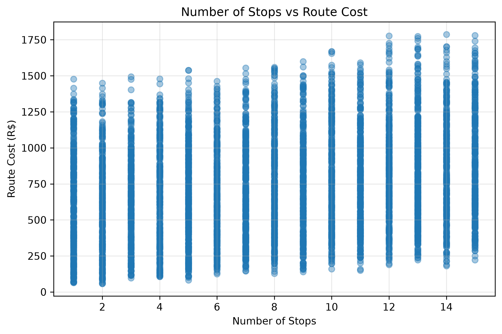
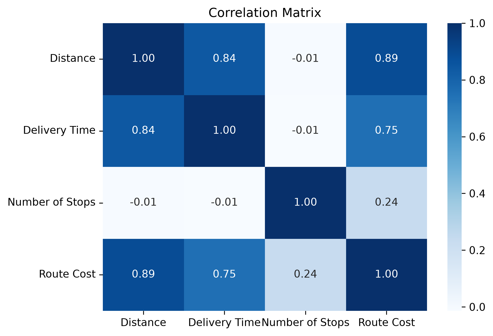
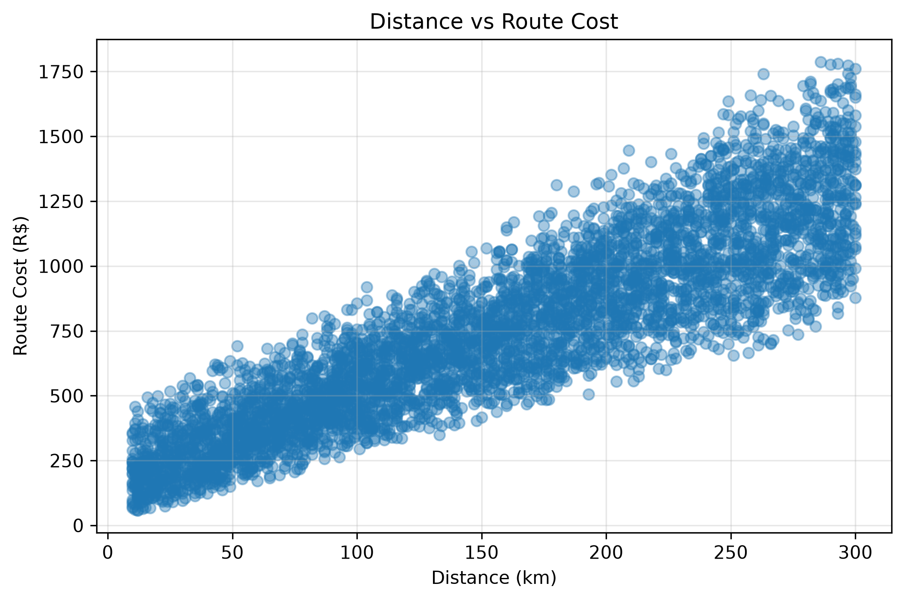

# Statistical Analysis of Logistics Operations Efficiency with NumPy

[English](README.md) | [Português](README.pt-BR.md)

## Overview

This project presents a statistical analysis of simulated logistics operations using Python and NumPy.

The objective is to explore how operational characteristics such as route distance, delivery time, number of stops, and route cost relate to each other and how statistical analysis can support the identification of high-cost and operationally efficient routes.

The dataset is entirely synthetic and was created specifically for study, experimentation, and portfolio purposes.

---

## Business Context

A logistics company operates a significant number of delivery routes and collects operational information such as distance traveled, delivery time, number of stops, and total route cost.

Although these data can support operational decisions, aggregated indicators alone may not provide enough visibility into the characteristics that differentiate high-cost routes from more efficient operations.

This project applies statistical analysis to explore these relationships and identify patterns that could support route planning and cost management.

---

## Business Questions

The analysis was designed to answer four main questions:

1. What is the average operational profile of the simulated routes in terms of distance, delivery time, number of stops, and route cost?
2. What characteristics differentiate high-cost routes from the overall operation?
3. Are there routes that travel longer-than-average distances while maintaining below-average operating costs?
4. What statistical relationships exist between distance traveled, delivery time, number of stops, and route cost?

---

## Dataset

The dataset contains **5,000 simulated logistics routes**.

Each route contains four main analytical variables:

| Variable | Description |
|---|---|
| `distance_km` | Distance traveled by the route in kilometers |
| `delivery_time` | Total delivery time in minutes |
| `num_of_stops` | Number of stops performed during the route |
| `route_cost` | Total simulated operating cost of the route |

Additional variables such as average speed, operational delay, cost per kilometer, and cost per stop were used only during the simulation process.

A fixed NumPy random seed (`100`) was used to ensure reproducibility.

---

## Simulation Logic

Route characteristics were generated using NumPy.

Distances were randomly generated between **10 and 300 km**.

Average route speeds varied between **35 and 90 km/h**, while random operational delays ranged between **10 and 90 minutes**.

The number of stops was generated independently between **1 and 15 stops per route**.

Route cost was calculated based on:

- distance traveled;
- variable cost per kilometer;
- number of stops;
- variable cost per stop.

The purpose was not to impose a predefined statistical distribution on the final route cost. Instead, the distribution emerges from the operational rules used in the simulation.

---

## Descriptive Statistical Analysis

The simulated operation produced the following overall profile:

| Metric | Result |
|---|---:|
| Average Distance | 155.44 km |
| Average Delivery Time | 210.17 min |
| Average Number of Stops | 7.99 |
| Average Route Cost | R$ 744.46 |
| Median Route Cost | R$ 718.32 |
| Route Cost Standard Deviation | R$ 355.52 |
| Minimum Route Cost | R$ 58.19 |
| Maximum Route Cost | R$ 1,787.44 |

The average route travels approximately **155 km**, requires around **210 minutes**, or 3.5 hours, and performs approximately **8 stops**.

The average operating cost is **R$ 744.46**, slightly above the median of **R$ 718.32**. This difference suggests a mild right-skew in the cost distribution, where a smaller number of more expensive routes increases the overall average.

The standard deviation of **R$ 355.52** represents considerable cost variability across the simulated operation.

---

## Route Cost Distribution



The histogram shows that route costs are concentrated mainly in intermediate ranges, while a smaller number of high-cost routes extends the distribution toward higher values.

The interval of one standard deviation around the mean is approximately:

- **-1 SD:** R$ 388.94
- **Mean:** R$ 744.46
- **+1 SD:** R$ 1,099.97

The mean being higher than the median reinforces the presence of a moderate right tail.

The simulated cost distribution is not perfectly normal, which is consistent with the project design: route costs were generated from different combinations of distance, variable kilometer cost, stops, and variable stop cost rather than directly sampled from a normal distribution.

---

## High-Cost Routes

High-cost routes were defined using the following statistical threshold:

```text
Route Cost > Mean Route Cost + 1 Standard Deviation
```

This resulted in a threshold of approximately **R$ 1,099.97**.

A total of **880 routes**, representing **17.6% of the dataset**, were classified as high-cost routes.

| Metric | Overall Operation | High-Cost Routes | Difference |
|---|---:|---:|---:|
| Average Distance | 155.44 km | 258.47 km | +66.3% |
| Average Delivery Time | 210.17 min | 318.33 min | +51.5% |
| Average Number of Stops | 7.99 | 9.48 | +18.6% |
| Average Route Cost | R$ 744.46 | R$ 1,297.21 | +74.3% |

High-cost routes are characterized mainly by substantially longer distances.

Their average distance is approximately **103 km greater** than the overall operation, while delivery time also increases significantly.

The number of stops grows much less proportionally than distance, suggesting that distance is a more distinctive characteristic of the high-cost segment in this simulated scenario.

---

## Operationally Efficient Routes

Operationally efficient routes were defined as routes meeting both conditions:

```text
Distance > Average Distance
AND
Route Cost < Average Route Cost
```

This criterion identified **338 routes**, representing **6.76% of the dataset**.

| Metric | Overall Operation | Efficient Routes | Difference |
|---|---:|---:|---:|
| Average Distance | 155.44 km | 185.75 km | +19.5% |
| Average Delivery Time | 210.17 min | 247.16 min | +17.6% |
| Average Number of Stops | 7.99 | 4.96 | -37.9% |
| Average Route Cost | R$ 744.46 | R$ 646.59 | -13.1% |

These routes travel approximately **19.5% farther than the overall average**, while maintaining costs approximately **13.1% below average**.

One of the most noticeable differences is the number of stops. Operationally efficient routes perform approximately **38% fewer stops** than the overall operation.

This does not establish that fewer stops cause lower costs, but it identifies a distinct operational profile worth further investigation.

---

## Correlation Analysis



The correlation matrix produced the following results:

| Variables | Correlation |
|---|---:|
| Distance × Route Cost | **0.89** |
| Distance × Delivery Time | **0.84** |
| Delivery Time × Route Cost | **0.75** |
| Number of Stops × Route Cost | **0.24** |
| Number of Stops × Distance | **-0.01** |
| Number of Stops × Delivery Time | **-0.01** |

### Analysis

The strongest relationship appears between **distance and route cost**, with a correlation coefficient of **0.89**.

This indicates a strong positive linear association: longer routes tend to have higher operating costs in the simulated dataset.

Distance is also strongly associated with delivery time (`0.84`), which is expected because distance is one of the factors used to calculate delivery time.

Delivery time and route cost show a correlation of `0.75`, indicating another strong positive association.

In contrast, the number of stops has only a **weak relationship with route cost (`0.24`)** and virtually no linear relationship with distance or delivery time.

Because this is a synthetic dataset, these coefficients partially reflect the rules used during simulation and should not be interpreted as causal evidence.

---

## Distance vs Route Cost



### Analysis

The scatter plot visually reinforces the strong positive relationship identified in the correlation matrix.

As route distance increases, total route cost also tends to increase.

However, routes with similar distances may still show substantially different costs. This dispersion is expected because the simulated cost per kilometer and cost per stop vary across routes.

The variability becomes more visible at longer distances, producing a wider range of possible operating costs.

Therefore, distance is strongly associated with route cost, but it does not explain the entire variation by itself.

---

## Number of Stops vs Route Cost


### Analysis

The relationship between the number of stops and route cost is much weaker.

For almost every number of stops, the dataset contains routes with a wide range of operating costs.

This visual pattern is consistent with the relatively low correlation coefficient of **0.24**.

Although stops contribute to route cost in the simulation, distance and kilometer-related costs have a substantially stronger influence on total cost variability.

---

## Route Cost Percentiles

The route cost distribution produced the following percentiles:

| Percentile | Route Cost |
|---|---:|
| 25th | R$ 455.87 |
| 50th | R$ 718.32 |
| 75th | R$ 999.10 |
| 90th | R$ 1,239.25 |
| 95th | R$ 1,368.95 |

The high-cost threshold of **R$ 1,099.97** falls between the 75th and 90th percentiles.

Because **17.6% of routes exceed this threshold**, it corresponds approximately to the **82.4th percentile** of the simulated operation.

This means that the high-cost segment represents roughly the most expensive **18% of routes**, rather than using an arbitrary fixed monetary threshold.

---

## Key Findings

The analysis produced five main findings:

- **Distance is the variable most strongly associated with route cost**, with a correlation coefficient of `0.89`.
- High-cost routes travel approximately **66% farther** than the overall average.
- High-cost routes represent **17.6%** of the simulated operation.
- Operationally efficient routes travel farther than average while maintaining costs approximately **13% below average**.
- Number of stops shows considerably less linear association with route cost than distance.

The analysis demonstrates how descriptive statistics, segmentation, percentiles, correlation analysis, and visualization can transform a simple simulated logistics dataset into operational insights.

---

## Business Implications

In a real logistics environment, this type of analysis could support investigations related to:

- route planning;
- cost monitoring;
- identification of unusually expensive operations;
- comparison of route efficiency;
- investigation of cost drivers;
- definition of operational benchmarks.

The project does not attempt to optimize routes or predict future costs. Instead, it establishes an analytical foundation that could later support forecasting, optimization, anomaly detection, or Machine Learning models.

---

## Technologies

- Python
- NumPy
- Pandas
- Matplotlib
- Seaborn
- Jupyter Notebook

---

## Project Structure

```text
logistics_operations_statistical_analysis/
│
├── data/
│   └── README.md
│
├── images/
│   ├── route_cost_distribution.png
│   ├── correlation_matrix.png
│   ├── distance_vs_route_cost.png
│   └── number_of_stops_vs_route_cost.png
│
├── notebooks/
│   └── logistics_operations_analysis.ipynb
│
├── README.md
├── README.pt-BR.md
├── requirements.txt
└── .gitignore
```

---

## Running the Project

Clone the repository:

```bash
git clone <repository-url>
```

Create a virtual environment:

```bash
python -m venv .venv
```

Activate the environment and install the dependencies:

```bash
python -m pip install -r requirements.txt
```

Open:

```text
notebooks/logistics_operations_analysis.ipynb
```

and run the notebook cells sequentially.

---

## Disclaimer

All data, operational rules, costs, thresholds, and scenarios used in this project are synthetic.

The project was developed exclusively for educational, experimental, and portfolio purposes and does not represent the operations of a real logistics company.